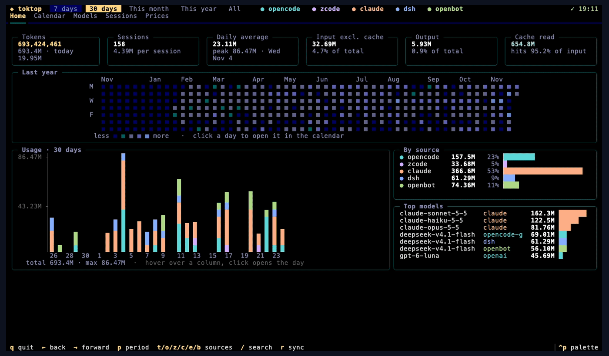

# toktop

**¿A dónde se van tus tokens de IA?** `toktop` es un panel de terminal con los tokens que gastas en tus herramientas de IA para programar: Claude Code, opencode, zcode, dsh y OpenBot. Cubre todas las herramientas, todos los modelos y todos los días, y muestra lo que costaría todo eso a precio de API.

Todo funciona en local. Lee los datos de uso que cada app ya guarda en disco. La única conexión a internet es una descarga anónima, una vez al día, de los precios públicos de los modelos.

[English](README.md)



## Qué hace

- **Una sola vista para todas las herramientas.** Cada fuente se enciende y se apaga por separado y tiene su propio color fijo.
- **Un histórico que nunca baja.** El uso se copia a una base de datos propia y cada valor se queda con el máximo visto. Si desinstalas una app o borra sesiones antiguas, tus totales se mantienen.
- **Mapa de calor anual, gráfico diario apilado y calendario.** Al pasar el ratón ves el detalle; al hacer clic en un día, lo abres.
- **Tablas de modelos y sesiones.** Se ordenan por cualquier columna y las sesiones se buscan por título, proyecto o modelo.
- **Precios que se actualizan solos.** Los precios públicos se bajan de OpenRouter una vez al día. Con ellos ves lo que costaría cada modelo a precio de API y una comparación de "qué pasaría si todo fuese con el modelo X".
- **Ratón y teclado.** Se adapta a partir de 80 columnas.
- **En inglés y en español.**

## Instalación

Necesitas Python 3.11 o superior.

```bash
pipx install toktop        # o: uv tool install toktop
toktop --lang es
```

Para probarlo sin tener ninguna app instalada, usa el modo demo. Usa datos inventados y no lee ni escribe nada:

```bash
toktop --demo
```

Para dejar el español fijo, pon `lang = "es"` en `~/.config/toktop/config.toml` o exporta `TOKTOP_LANG=es`. Si tu sistema está en español, se elige solo.

## Uso

```text
toktop                 abre el panel
toktop -s claude       empieza mostrando una sola fuente (opencode | zcode | claude | dsh | openbot)
toktop --text          resumen en texto plano (también al redirigir la salida: toktop | less)
toktop --rebuild       vuelve a leer desde cero las apps instaladas (lo de las apps borradas se conserva)
toktop --demo          datos inventados
toktop --lang es       idioma de la interfaz
```

**Teclas:**
- `1`–`5` cambian de pestaña.
- `←` / `→` cambian de mes en el calendario, o de periodo en el resto. `p` pasa al siguiente periodo.
- `o` `z` `c` `e` `b` encienden o apagan una fuente y `t` las enciende todas.
- `/` busca sesiones.
- `r` vuelve a leer las apps.
- `q` sale y `Ctrl+P` abre la paleta de comandos.

## Fuentes

| Fuente | Qué lee |
|---|---|
| **Claude Code** | `~/.claude/projects/**/*.jsonl`: el `message.usage` de cada respuesta. Cada mensaje cuenta una vez, aunque llegue repartido en varias líneas. |
| **opencode** | `opencode.db` (`session_v2`, o `session` en versiones antiguas): una fila por sesión, con título y carpeta. |
| **zcode** | `~/.zcode/cli/db/db.sqlite`, tabla `model_usage`. Su `input_tokens` incluye la caché leída, así que se descuenta. |
| **dsh** | Un registro JSONL con una línea por petición. Los nombres de proyecto salen de `~/.dsh/sessions`. |
| **OpenBot** | Los agentes de OpenBot funcionan sobre Claude Code y opencode. Las sesiones cuya carpeta está en `…/OpenBot/…` cuentan como `openbot` en vez de contarse dos veces, y llevan el nombre del agente. |

Las rutas se detectan en macOS, Linux y Windows. Si alguna app guarda sus datos en otro sitio, o quieres desactivar una fuente, usa [`config.example.toml`](config.example.toml) como plantilla.

## Cómo funciona

- **Histórico.** toktop guarda su propio `history.db` en `~/.local/share/toktop/` (en Windows, `%LOCALAPPDATA%\toktop\`). Cada arranque vuelca lo que dicen las apps y se queda con el máximo de cada contador. El panel abre al momento con el histórico y se actualiza cuando termina la lectura en segundo plano.
- **Precios.** La [lista pública de OpenRouter](https://openrouter.ai/api/v1/models) se guarda 24 h en `prices.json`. Sin conexión se usa esa copia y, si no existe, una tabla interna. El razonamiento se cobra como output. Los planes de suscripción no se facturan por token, así que los costes son orientativos.
- **Privacidad.** Ni telemetría ni cuentas. La petición de precios es un GET anónimo.

## Licencia

[MIT](LICENSE)
