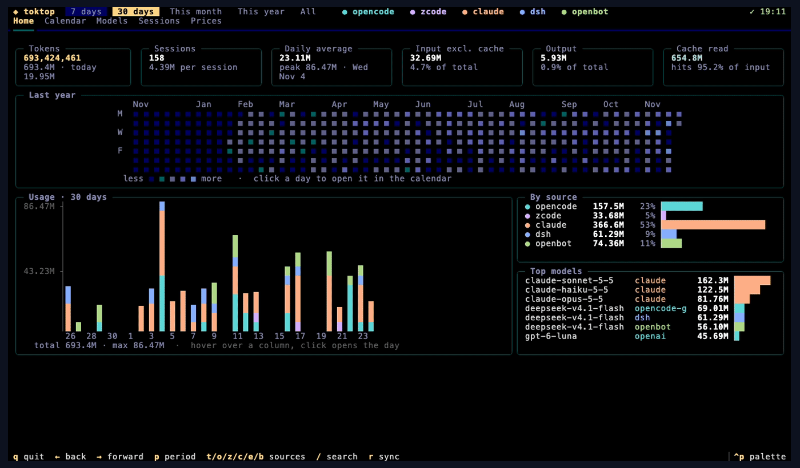
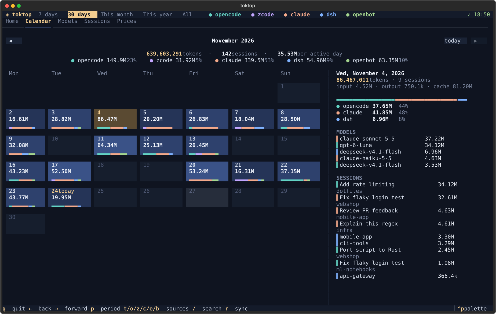
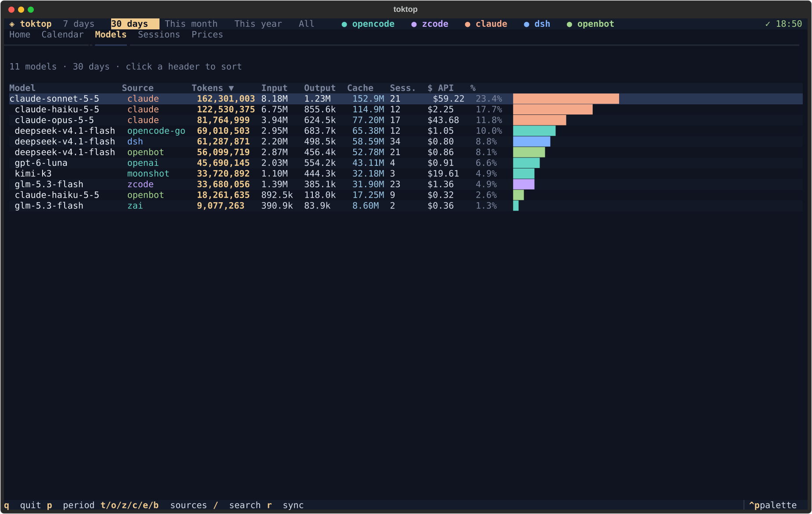
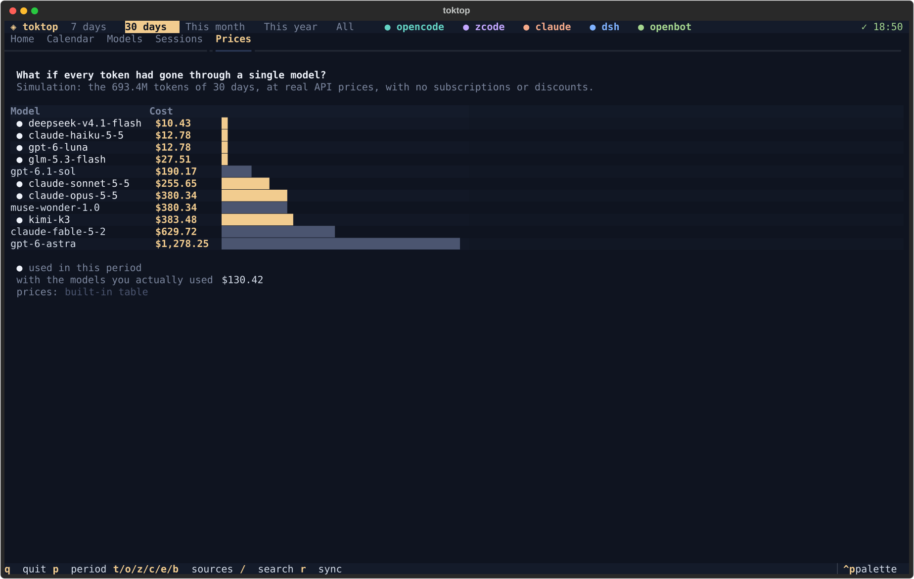

# toktop

**Where do your AI tokens go?** `toktop` is a terminal dashboard of the tokens you spend across your AI coding tools: Claude Code, Codex, Gemini CLI, opencode, Cline and ten more. It covers every tool, every model and every day, and shows what all of it would cost at API prices.

Everything runs locally. It reads the usage data each app already keeps on disk. The only network call it makes is an anonymous daily download of public model prices.

[Español](README.es.md)



## Features

- **One view for every tool.** On first launch you pick the apps you use from a list; toktop finds their data on its own. Each source has its own colour and can be switched on and off.
- **History that never shrinks.** Usage is copied into toktop's own database, and each value keeps its maximum. If you uninstall an app or it prunes old sessions, your totals stay.
- **Yearly heatmap, stacked daily chart and a calendar.** Hover for details and click a day to drill in.
- **Models and sessions tables.** Sort them by any column and search sessions by title, project or model.
- **Prices that update themselves.** Public prices are fetched from OpenRouter once a day. They give you an API-price estimate per model and a "what if everything ran on model X" comparison.
- **Mouse and keyboard friendly.** The layout adapts from 80 columns upward.
- **English and Spanish.**

| Calendar | Models |
|---|---|
|  |  |

## Install

You need Python 3.11+.

```bash
pipx install toktop        # or: uv tool install toktop
toktop
```

Try it without any of the apps installed. The demo uses made-up data, and reads and writes nothing:

```bash
toktop --demo
```

From source:

```bash
git clone https://github.com/xlydevs/toktop && cd toktop
uv venv && uv pip install -e ".[dev]"
.venv/bin/toktop
```

## Usage

```text
toktop                 open the dashboard
toktop -s claude       start with only one source (claude | codex | gemini | opencode | …)
toktop --text          plain-text summary (also used automatically when piping: toktop | less)
toktop --rebuild       re-read the installed apps from scratch (data from deleted apps is kept)
toktop --demo          made-up data
toktop --lang es       interface language (default: system locale)
```

**Keys:**
- `1`–`5` switch tabs.
- `←` / `→` change the month in the calendar, or the period elsewhere. `p` moves to the next period.
- `o` `z` `c` `e` `b` toggle a source and `t` turns them all on.
- `a` opens the app list.
- `/` searches sessions.
- `r` re-reads the apps.
- `q` quits and `Ctrl+P` opens the command palette.



## Supported sources

These are read automatically once checked in the app list (`a`):

| App | What it reads |
|---|---|
| **Claude Code** | `~/.claude/projects/**/*.jsonl`: `message.usage` of each assistant message, counted once even when streamed across several lines. |
| **Codex CLI** | `~/.codex/sessions/**/rollout-*.jsonl`: per-request `token_count` deltas. Replays in forked sessions are skipped. |
| **Gemini CLI** | `~/.gemini/tmp/*/chats/session-*`: the `tokens` of each Gemini message. |
| **Qwen Code** | `~/.qwen/projects/*/chats/*.jsonl`: `usageMetadata` of each assistant record. |
| **opencode** | `opencode.db` (`session_v2`, or `session` in older versions): one row per session, with title and folder. |
| **Goose** | `goose/sessions/sessions.db`: the per-request `usage_ledger`, or each session's totals in older versions. |
| **Amp** | `~/.local/share/amp/threads/T-*.json`: usage of each assistant message. |
| **Cline, Roo Code, Kilo Code** | `tasks/*/ui_messages.json` in the extension's storage of VS Code, Cursor, Windsurf, VSCodium and other forks. |
| **Zed** | `threads/threads.db`: token usage of each agent thread (zstd-compressed threads need Python 3.14+ or the `zstandard` package). |
| **zcode** | `~/.zcode/cli/db/db.sqlite`, table `model_usage`. Its `input_tokens` includes cache reads, so they are subtracted. |
| **OpenBot** | OpenBot agents run on Claude Code and opencode. Sessions whose folder lives under `…/OpenBot/…` count as `openbot` instead of being counted twice, and they are named after the agent. |

These need a one-time setup. When you check them, toktop shows a text to paste into your AI agent so it sets them up for you:

| App | How |
|---|---|
| **dsh** (deepseek-harness) | A plugin appends one JSON line per request to `deepseek-harness.jsonl` in toktop's data folder. |
| **Aider** | `analytics-log:` in `~/.aider.conf.yml` makes Aider write a local event log (it does not send anything). That log has no cache split. |

Cursor, Windsurf and GitHub Copilot keep usage only on their servers, so they can't be read locally. Crush only stores the last request's tokens, so it can't be totalled either.

Paths are detected on macOS, Linux and Windows. If an app keeps its data somewhere else, or you want to switch a source off, use a config file (see [`config.example.toml`](config.example.toml)): `~/.config/toktop/config.toml` (Windows: `%APPDATA%\toktop\config.toml`).

## How it works

- **History.** toktop keeps its own `history.db` in `~/.local/share/toktop/` (Windows: `%LOCALAPPDATA%\toktop\`). It stores usage per source, session, day and model. Each run upserts what the apps report, keeping the maximum of each counter, so numbers never go down. The dashboard opens instantly from the history and refreshes when the background read finishes. The top bar shows which sources are "history only" because the app is gone.
- **Prices.** The public [OpenRouter model list](https://openrouter.ai/api/v1/models) is cached in `prices.json` for 24 h, and a built-in table covers offline use. Model ids are normalised, so names like `claude-opus-5.5`, `anthropic/claude-opus-5-5` and `…-free` variants match. Reasoning tokens are billed as output, and cache writes use the cache-write price when one is published. Subscription plans are not billed per token, so the costs shown are estimates.
- **Privacy.** No telemetry and no accounts. The price request is a plain anonymous GET.

## Development

```bash
uv venv && uv pip install -e ".[dev]"
.venv/bin/pytest          # tests use temporary fake app data, never your real files
uvx ruff check .
```

The code lives in `src/toktop/`:
- `sources.py`: one reader per app.
- `history.py`: the database.
- `prices.py`: OpenRouter prices.
- `stats.py`: aggregations.
- `tui.py`: the Textual app.
- `text.py`: the plain-text summary.
- `i18n.py`: translations.

## License

[MIT](LICENSE)
